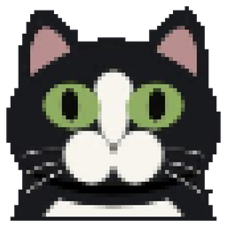

<div align="center">



# 小叽 · 桌面版

**一只住在你桌面上的 3D 小猫。**

它会跟着你的键盘和鼠标转头，会在没人理它的时候自己睡着，
还会在你敲密码的时候悄悄扭头 —— 装作什么都没看见。

[功能](#功能) · [快速开始](#快速开始) · [构建](#构建) · [项目结构](#项目结构) · [自定义皮肤](#自定义皮肤) · [常见问题](#常见问题)

</div>

---

## 这是什么

小叽（LittleThing）是一只 3D 桌面宠物。桌面版是它的 Electron 封装版本，
把浏览器里那只小猫搬到了你的桌面上：透明无边框、永远置顶、鼠标移上去才可点。

和网页版共用同一套 3D 渲染与皮肤系统，所以你在网页版做的皮肤，
拷一份到桌面版照样能用。

## 功能

### 🐱 小猫

| | |
|---|---|
| **3D 实时渲染** | WebGL + three.js，程序化生成，无外部模型资源 |
| **键盘 / 鼠标跟随** | 全局钩子捕获输入，小猫会朝你打字的方向转头、跟到鼠标位置 |
| **自动入睡** | 默认闲置 2 分钟自己睡着，可调；被唤醒时眨眨眼、弹一下 |
| **待机小动作** | 舔爪、左右张望、歪头、抖耳朵，6~14 秒随机一次 |
| **空闲降频** | 活跃 60fps → 空闲 30fps → 深度空闲 15fps，空闲时 rAF 彻底停下让合成器进入低功耗 |
| **多显示器** | 拔掉扩展屏或改分辨率后，自动把猫拉回可见区域 |

### 🔒 保密模式

你正在输入密码时，小猫会**扭头看向别处**，同时眯起眼睛装作什么都没发生。

实现方式是主进程每 250 毫秒探测一次系统焦点控件是否落在密码框上。
探测在系统层进行，不读任何按键内容 —— 它只知道「现在是不是在输密码」。

为了保证这个功能真正可用，桌宠窗口**绝不允许抢走输入焦点**：
一旦抢走，你在密码框里就一个字都打不进去了。

### 🖱️ 桌面交互

- **鼠标穿透** —— 鼠标不在猫身上时，点击直接穿透到下面的窗口
- **拖动** —— 按住拖动可以把它挪到任意位置，位置会被记住
- **右键菜单** —— 显示/隐藏、设置、演示窗口、回到屏幕内、退出
- **托盘常驻** —— 关闭窗口应用不会退出，托盘图标一直都在
- **全局快捷键** —— `Ctrl+Alt+S` 打开设置，`Ctrl+Alt+H` 显示/隐藏小猫

### 🎨 自定义皮肤

一套完整的皮肤编辑器，配实时 3D 预览（见 [自定义皮肤](#自定义皮肤)）。

### ⚙️ 设置

界面语言 · 毛色/皮肤 · 显示键盘 · 显示鼠标 · 左手鼠标布局 · 演示模式（自动打字）·
全局键盘跟随 · 全局鼠标跟随 · 入睡等待 · 窗口大小 · 不透明度 · 永远置顶 ·
开机自动启动 · 允许拖动 · 保密模式 · 诊断日志

## 快速开始

### 环境要求

- **Node.js ≥ 22.12**（Electron 45 的硬性要求）
- **Windows 10+**（全局输入钩子依赖 Win32 低层钩子，目前仅 Windows 可用）
- macOS / Linux 可以运行主界面，但**全局键盘鼠标跟随不可用**

### 安装与启动

```bash
git clone <this-repo>
cd littlething-desktop

# 安装依赖
pnpm install       # 或 npm install

# 开发模式运行
pnpm start
```

> **关于 pnpm**
> pnpm 10+ 默认不执行依赖的 postinstall 脚本，
> 会导致 `node_modules/electron/dist` 是空的，一启动就报
> `Electron failed to install correctly`。
> 本项目已在 `package.json` 的 `postinstall` 里挂了 `scripts/ensure-electron.js` 兜底，
> 缺二进制时自动从国内镜像补下（约 100~200 MB）。

### 直接用打包好的版本

从 [Releases](https://github.com/astroschen/littlething-desktop/releases) 下载：

- `LittleThing-Setup-x.x.x.exe` —— 安装版，带开机自启和开始菜单
- `LittleThing-x.x.x.exe` —— 便携版，双击即用，绿色无残留

> 下载文件名用的是英文 `LittleThing` 而不是「小叽」：GitHub 的 Release 附件名
> 会把非 ASCII 字符和空格剥掉，中文名上传后会被改成 `Setup.x.x.x.exe` 这种
> 莫名其妙的字符串。构建配置里的 `artifactName` 已经固定成英文名，产物名和
> 上传后的名字保持一致。

## 构建

```bash
pnpm build:win     # Windows：NSIS 安装版 + 便携版
pnpm build:mac     # macOS：universal dmg
pnpm build:linux   # Linux：AppImage + deb
```

产物落在 `dist/`。

构建脚本默认走**国内镜像**（`npmmirror.com`），避免直连 GitHub 下载 electron-builder
二进制超时。需要换源时设置环境变量即可：

```bash
ELECTRON_MIRROR=https://npmmirror.com/mirrors/electron/
ELECTRON_BUILDER_BINARIES_MIRROR=https://npmmirror.com/mirrors/electron-builder-binaries/
```

## 项目结构

```
littlething-desktop/
├── main.js               # Electron 主进程：窗口、托盘、IPC、配置、钩子调度
├── preload.js            # contextBridge 暴露的三个 API 面
├── native-hook.js        # 主进程内的 Win32 低层输入钩子（koffi）
├── password-probe.js     # 密码框探测（保密模式）
│
├── pet.html / pet.js     # 桌宠窗口：透明背景、穿透、拖动、右键菜单
├── settings.html/js      # 设置窗口
├── skin-editor.html      # 皮肤编辑器窗口
├── editor.js             # 皮肤编辑器的桌面宿主（接存储层）
├── index.html / app.js   # 演示窗口（网页版的桌面实现）
│
├── assets/
│   ├── cat.js             # 3D 小猫本体（程序化生成，含皮肤编辑器内核）
│   ├── skins.js           # 内建皮肤、调色板、花纹绘制
│   ├── skin-editor.js     # 编辑器面板（与网页版共享）
│   ├── skin-editor.css    # 编辑器样式
│   ├── skin-store.js      # 皮肤存储层（格式与网页版完全一致）
│   ├── three.min.js       # three.js
│   └── icons/             # 应用 / 托盘图标
│
├── resources/hook/        # 打包进 extraResources 的原生依赖（koffi）
├── scripts/
│   ├── build.js           # 打包入口（清 dist → 调 electron-builder）
│   ├── clean-dist.js      # 分批清理 dist/win-unpacked
│   └── ensure-electron.js # 补装 Electron 二进制
│
└── build/icon/            # 图标源文件与生成脚本
```

### 架构上的几个要点

**1. 两端共享一套核心，宿主各管各的。**
`assets/cat.js`、`assets/skin-editor.js`、`assets/skins.js`、`assets/skin-store.js`
与网页版**逐字节相同**。差异只在宿主层：
网页版 `app.js` 用 localStorage，桌面版 `editor.js` 用磁盘文件。
存储层把读写函数当参数接收，所以格式和簿记只有一处实现。

**2. 皮肤是三层纹理。**
`base`（纯色底）/ `pattern`（内建花纹）/ `stroke`（用户画笔）。
改毛色只重画 `base` + 重画 `pattern`，**永远不碰 `stroke` 层** ——
这就是「画完再改色不丢笔迹」「换底子不丢笔迹」的机制根源。

**3. 主进程裁决鼠标穿透。**
窗口一旦开启穿透就收不到自己的 `mousemove`，渲染进程无法自救，
所以穿透裁决必须由主进程用 `screen.getCursorScreenPoint()` 来做。
另有 16ms 一轮的轮询兜底 —— 即使全局钩子失败，鼠标也一定移得进猫身上。

**4. 全局输入钩子跑在主进程内。**
用 koffi 直接调 Win32 的 `WH_KEYBOARD_LL` / `WH_MOUSE_LL`，
取代了旧的「独立 node.exe 子进程 + stdout JSON 解析」链路 ——
省掉 69MB 运行时，少一层解析，事件直达主进程。

## 自定义皮肤

设置窗口 →「自定义皮肤」→「✎ 编辑皮肤…」（也可以在演示窗口里进入）。
打开编辑器时会自动以**当前穿着的那件**皮肤作为起点。

### 编辑器能做什么

- **基础皮肤** —— 选一件现成的皮肤当底子（9 件内建 + 你自己的），
  它的花纹会带进来，你再在上面改
- **配色** —— 毛色、斑块、描边、条纹、眼睛、耳内、尾巴，七项独立可调
- **体型** —— 21 个滑块，从头的大小、耳朵尺寸、眼睛间距到身体宽高、腿的粗细、脚的大小、尾巴粗细，可一键「恢复默认」
- **花纹（涂绘）** —— 在 256×256 纹理上直接绘制，
  可切换身体 / 头部 / 四条腿 / 尾巴等槽位分别作画，
  提供画笔、填充、擦除三种工具

> 花纹**类型**（虎斑 / 三花 / 符文 / 燕尾等）由「基础皮肤」决定 ——
> 换底子会把那件皮肤的花纹一起带进来，你再在上面手绘修改。

### 换底子时保留什么

| | 保留 | 替换 |
|---|:---:|:---:|
| 你的画笔笔迹 | ✅ | |
| 体型 | ✅ | |
| 正在编辑这件皮肤的 id | ✅ | |
| 底色 + 花纹 | | ✅ |
| 你手打的颜色 | | ❌ |

手打的颜色属于旧底子的调色板，混两套调色板会得到哪件都不像的结果，
所以换底子时会被舍去。

### 皮肤存哪儿

| | 桌面版 | 网页版 |
|---|---|---|
| 位置 | `%APPDATA%\littlething-cat-desktop\custom-skins.json` | localStorage `littlething.skins` |

**两边格式完全一样**（`{ version: 1, skins: [...] }`），
所以网页版做的皮肤拷到桌面版就能用，反之亦然。

### 内建皮肤

叽吧猫 · 奶牛猫 · 橘猫 · 狸花猫 · 三花猫 · 白猫 · 蓝灰猫 · 符文猫 · 元首猫

## 常见问题

<details>
<summary><b>启动报「Electron failed to install correctly」</b></summary>

`node_modules/electron/dist` 是空的。pnpm 10+ 不执行依赖的 postinstall。

```bash
node node_modules/electron/install.js
```

或直接删掉 `node_modules/electron` 重装。根 `package.json` 的 `postinstall`
已经挂了 `scripts/ensure-electron.js` 兜底，正常 `pnpm install` 不该遇到。
</details>

<details>
<summary><b>鼠标移到猫身上点不动</b></summary>

这是穿透逻辑在起作用 —— 正常情况下鼠标离开猫身就穿透到底下的窗口。
如果鼠标**确实在**猫身上却点不到，试试关掉设置里的「全局鼠标跟随」再开一次；
另外确认「允许拖动猫咪」没有被误关。

托盘菜单里的「窗口回到屏幕内」可以把跑到屏幕外的猫拉回来。
</details>

<details>
<summary><b>全局键盘/鼠标跟随没反应</b></summary>

原生钩子目前**只支持 Windows**。macOS/Linux 上猫照常显示，
但只能在应用内响应输入。

打开「启用诊断日志」，日志写在系统临时目录的 `littlething-pet-debug.log`，
里面会记录钩子的启动结果。
</details>

<details>
<summary><b>保密模式下猫一直扭头</b></summary>

探测器问的是「系统焦点控件是不是密码框」。
某些第三方密码管理器用的是自绘控件而不是标准密码框，系统层面识别不出来。

可以在设置里关掉「保密模式（输密码时扭头不看）」。
</details>

<details>
<summary><b>改了设置但猫没反应</b></summary>

托盘里「窗口回到屏幕内」可以解决窗口跑出屏幕范围的情况。
另外设置窗口保存后会自动关闭，重新打开即可看到最新状态。
</details>

## 许可

本项目基于 MIT License 发布 —— 详见 [LICENSE](LICENSE)。

第三方组件的许可信息见 [THIRD_PARTY_LICENSES.md](THIRD_PARTY_LICENSES.md)。
